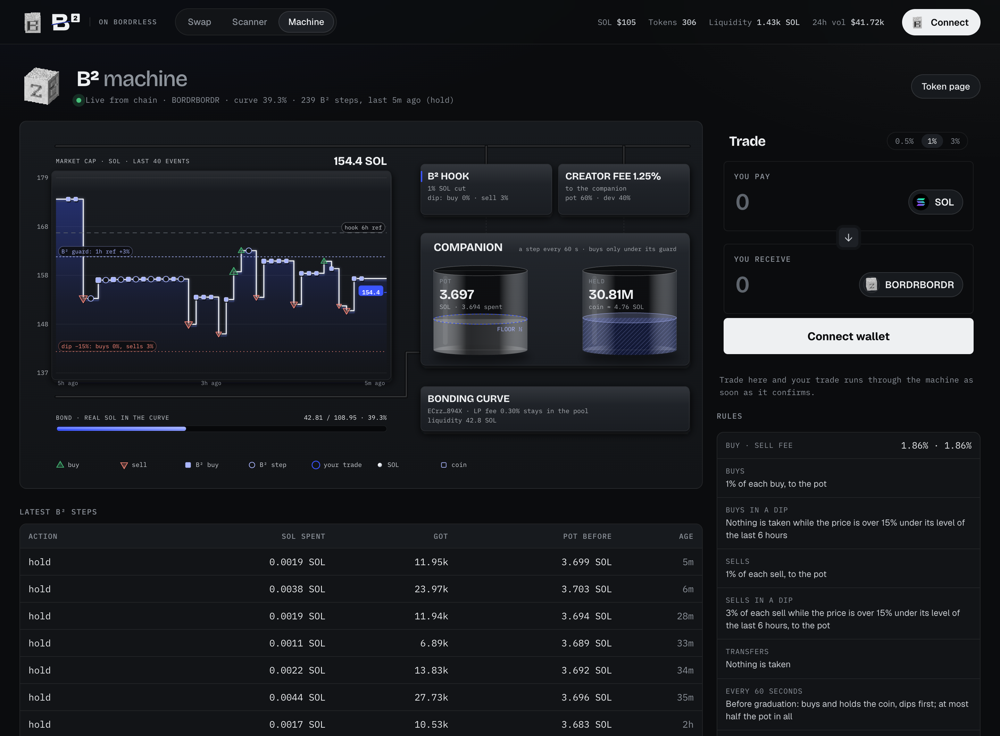
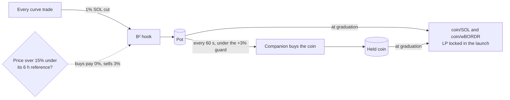
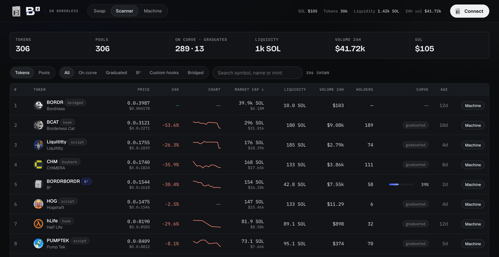
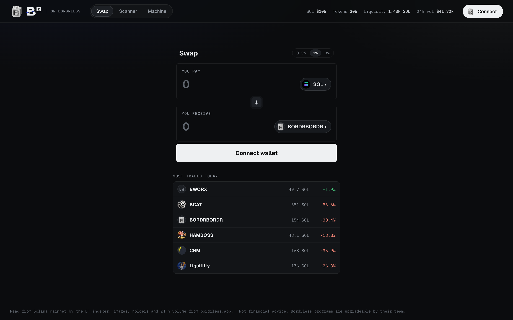
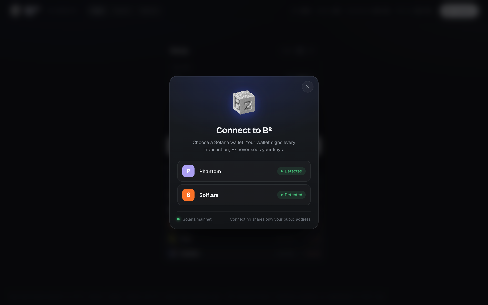
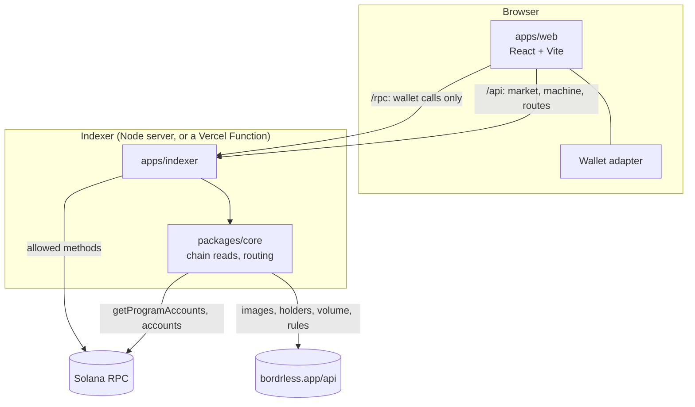

<div align="center">


# B²

**A Bordrless Workshop pair that turns every trade into BORDR liquidity, and the open-source app around it:
a swap for the whole Bordrless ecosystem, a market scanner, and a live machine view of every coin's rules.**

[](LICENSE)
[](https://solscan.io/account/5HZP9Nn6ScGzduvsadvDEUuZnz5Xz7yynzxuxPRHmnre)
[](https://bordrless.app)
[](programs/b2)
[](packages/core)
[](package.json)

[](https://vercel.com/new/clone?repository-url=https%3A%2F%2Fgithub.com%2Fcloutprotocol%2FB2&env=B2_RPC&envDescription=A%20Solana%20mainnet%20RPC%20URL%20that%20serves%20getProgramAccounts&project-name=b2)

<br />



<sub>The machine view: every trade's money, live from chain, running to where the coin's rules send it.</sub>

</div>

---

## Contents

- [What B² is](#what-b-is)
- [How the pair works](#how-the-pair-works)
- [The app](#the-app)
- [Architecture](#architecture)
- [Quick start](#quick-start)
- [Configuration](#configuration)
- [Deploy](#deploy)
- [How it reads the chain](#how-it-reads-the-chain)
- [Swaps](#swaps)
- [The program](#the-program)
- [Project layout](#project-layout)
- [Security model](#security-model)
- [Contributing](#contributing)
- [License](#license)

## What B² is

[Bordrless](https://bordrless.app) is a Solana launchpad and DEX where a coin can carry a **hook** (rules that run on
every trade) and a **companion script** (a program that acts for the coin on a schedule). Together they make a
Workshop **pair**.

B² is such a pair. It takes a 1% SOL cut on every curve trade, buys the coin with it under a price guard, and at
graduation seeds two pools with the LP locked inside the launch: coin/SOL and coin/wBORDR. Every B² coin that
graduates adds permanent BORDR liquidity.

This repository holds the pair itself and everything we built around it, all of it open source:

| | |
| --- | --- |
| **The pair** | the hook and companion script, as submitted to the Workshop and deployed on mainnet, with LiteSVM tests against the real Bordrless programs |
| **The indexer** | a server that reads the whole Bordrless market from chain, enriches it, prepares swaps and proxies wallet RPC |
| **The app** | Swap, Scanner, token pages and the Machine view, for any Bordrless coin, not only B² |

## How the pair works



- **The cut.** The hook takes 1% of every curve trade, in SOL, into the companion's pot.
- **The buy.** Every 60 seconds the companion steps. Before graduation it buys and holds the coin, dips first, and
  only while the price is under its one-hour reference plus 3%, so it never chases a pump. At most half the pot
  goes on buys.
- **Dip Buy.** When the price falls more than 15% under its six-hour reference, buyers pay no hook fee and sellers
  pay 3%, which leans the curve toward recovery.
- **Graduation.** The pot and the held coin seed coin/SOL and coin/wBORDR, with the LP locked in the launch for
  good.

The first B² coin is
[`4iWwcHf9…bps6H7J`](https://solscan.io/token/4iWwcHf9tH6J6UjRgG9rXosXVxNdcKUFuqh1rbps6H7J).

## The app

| Machine | Scanner |
| --- | --- |
|  |  |
| **Swap** | **Connect** |
|  |  |

- **Swap.** Any Bordrless token to any other, routed through the best direct pool or one hop. Quotes and
  transactions are built here with the Bordrless SDK, and the wallet signs.
- **Scanner.** Every token and pool on the Bordrless DEX: price, market cap, liquidity, 24 h volume, holders, curve
  progress. Filter by curve, graduated, B², custom hooks or bridged tokens.
- **Machine.** Any coin's rules drawn as a machine: its last 40 trades on the chart, and every trade's money running
  to the hook, the creator fee, holders, the burn and its companion. B² coins add the pot, its floor and the held
  coin. Your own trades join the drawing as soon as they confirm. On a phone it reflows into a tall layout.
- **Wallet connect.** Detected wallets first, what each step is waiting on, errors in plain words, install links for
  the rest. Connecting shares only the public address.

## Architecture



- The browser never sees the RPC key. It sends wallet calls to `/rpc`, and the indexer forwards only the methods a
  swap needs.
- The indexer runs two ways from one codebase: as a long-running server (`apps/indexer/src/main.ts`, refreshed on
  timers) or as a Vercel Function (`apps/indexer/src/vercel.ts`, refreshed on demand).

## Quick start

Requires Node 22 or newer and a Solana mainnet RPC URL that serves `getProgramAccounts` (QuickNode, Helius, Triton
and similar).

```sh
git clone https://github.com/cloutprotocol/B2.git
cd B2
cp .env.example .env      # set B2_RPC
npm install
npm run dev               # indexer on :8787, web on http://localhost:5173
```

| Script | Does |
| --- | --- |
| `npm run dev` | the indexer and the web app together, with hot reload |
| `npm run build` | the web app into `apps/web/dist` |
| `npm run typecheck` | both apps |
| `npm run vercel-build` | the full Vercel build output into `.vercel/output` |

## Configuration

| Variable | Required | Default | Meaning |
| --- | --- | --- | --- |
| `B2_RPC` | yes | | Solana mainnet RPC URL. It must serve `getProgramAccounts` and version 1 transactions. |
| `PORT` | | `8787` | The indexer's port (server mode). |
| `B2_FEE_WALLET` | | | Turns on the router's integrator fee, paid to this wallet. It must hold rent (about 0.001 SOL). |
| `B2_FEE_BPS` | | `50` | The integrator fee, 1 to 100 basis points. Bordrless keeps a fifth. |
| `B2_INDEXER` | | `http://localhost:8787` | Where the Vite dev server proxies `/api` and `/rpc`. |

## Deploy

### Vercel (one click)

The button above clones the repo into your Vercel account and asks for `B2_RPC`. The build
(`scripts/vercel-build.mjs`) writes Vercel's Build Output API directly:

- **`static/`**: the web app;
- **`functions/indexer.func`**: the indexer, bundled into one file with esbuild;
- **routes**: `/api/*` and `/rpc` go to the function, every other path to the app.

As a function, the indexer refreshes the market on request, sharing one refresh between concurrent requests. It
serves cached data while a refresh runs and waits only when it has none. One cost: the 24 h volume it would compute
itself after a day of uptime. It reports Bordrless's figure instead.

### Anywhere else

Run `npm run build`, serve `apps/web/dist`, and run `npm start -w @b2/indexer` behind the same origin, with `/api`
and `/rpc` routed to it.

## How it reads the chain

- **Pools.** `getProgramAccounts` on the Bordrless DEX (411-byte pool accounts), decoded with `@bordrless/sdk`. Price
  is the books' `quoteReserve + virtualQuote` over `baseReserve + virtualBase`. A curve's liquidity is its real SOL
  only; a pool's is both sides.
- **Tokens.** Every mint the pools trade, priced by its deepest SOL pool. Market cap is price times supply; for a
  bridged token (wBORDR), the underlying SPL mint's supply.
- **Launches.** Every launch account, for curve progress (`quoteReserve / graduationQuote`) and status.
- **B².** The hook's `DipState` (`["state", mint]` under the hook), the script's `PairState` (`["script-state",
  mint]` under the companion program), the companion's SOL and held coin, and the `Stepped` events of every step.
  The layouts mirror `programs/b2`.
- **From bordrless.app/api** (public, no key): images, holders, 24 h volume and change, the rules, candles and
  trades.

## Swaps

Any token to any token (`packages/core/src/route.ts`, served as `/api/route/quote` and `/api/route/prepare`):

- **Routes.**
  - Every direct pool, and every path through one token both sides trade against (SOL, wBORDR, anything). The best
    output wins.
  - A two-leg route is one transaction when it fits in 1,232 bytes; otherwise one per leg, signed as a batch. The
    second leg spends what the first is sure to deliver.
- **Legs**, all built here with the SDK:
  - a launch's curve or pool, through its launch keys (kit, custom hook and SOL cut resolved);
  - any other pool, with each side's token hook and its pool hook resolved;
  - a pool quoted in bridged SOL, which wraps the input and unwraps what it delivers.
- **Quotes.**
  - Constant product on each pool's books, with that side's fees. For a launch: its whole buy or sell fee plus its
    hook's cut from the Workshop reading. For a pool: its LP and protocol fee.
  - Slippage sets each leg's minimum, which also protects a trade through a hook that publishes no reading.
- **The router fee** (optional, `B2_FEE_WALLET`).
  - The leg that moves SOL goes through Bordrless's router: a buy pays from its input, a sell from the SOL it
    delivers.
  - Native pools pay it in SOL. Pools quoted in bridged SOL pay it in bridged SOL, once the fee wallet has a bridged
    SOL holding.
- **Fallback.** If a single launch leg can't be built here, Bordrless's own `/api/swap/prepare` builds it.

`packages/core/scripts/simulate-routes.ts` builds real routes and simulates them on mainnet.

## The program

| | Mainnet |
| --- | --- |
| Companion script | [`5HZP9Nn6ScGzduvsadvDEUuZnz5Xz7yynzxuxPRHmnre`](https://solscan.io/account/5HZP9Nn6ScGzduvsadvDEUuZnz5Xz7yynzxuxPRHmnre) |
| Hook | [`8Bb1WwMZ4sZkvaDETUwdBgDgdA7NPQuEWd81Q5uDoorb`](https://solscan.io/account/8Bb1WwMZ4sZkvaDETUwdBgDgdA7NPQuEWd81Q5uDoorb) |

Bordrless deployed the pair under their own program ids. The `declare_id!`s in the source are the keypairs the tests
build under. Build, test and the Workshop's source rules: [`programs/b2/README.md`](programs/b2/README.md).

## Project layout

```
programs/b2       the Workshop pair (Rust, Anchor 1.2): hook/, script/, submission/, LiteSVM tests/, fixtures/
packages/core     chain reads: pools, mints, launches, bridged tokens, B²'s state, routing
apps/indexer      app.ts (the API and the RPC proxy), main.ts (server), vercel.ts (function)
apps/web          Swap, Scanner, token pages, Machine view, wallet connect (React, Vite)
scripts           dev.mjs (both apps), vercel-build.mjs, fix-bordrless-packages.mjs
docs/media        the screenshots in this README
```

## Security model

- **Keys.**
  - The app never handles a private key: the wallet signs every transaction it builds.
  - Program keypairs never enter the repo (`programs/b2/keys/` is gitignored).
- **RPC.**
  - The RPC URL lives server-side (`.env`, or the host's environment).
  - The browser reaches it only through `/rpc`, which allows the methods a wallet swap needs and refuses anything
    that scans.
- **Trust.**
  - Bordrless programs are upgradeable by their team.
  - The pair's numbers (the cut, the guard, Dip Buy) are fixed in its deployed code.
  - Nothing here is financial advice.

To report a vulnerability, see [SECURITY.md](SECURITY.md).

## Contributing

Issues and pull requests are welcome. See [CONTRIBUTING.md](CONTRIBUTING.md) for the setup and the checks a change
should pass.

## License

[MIT](LICENSE)
